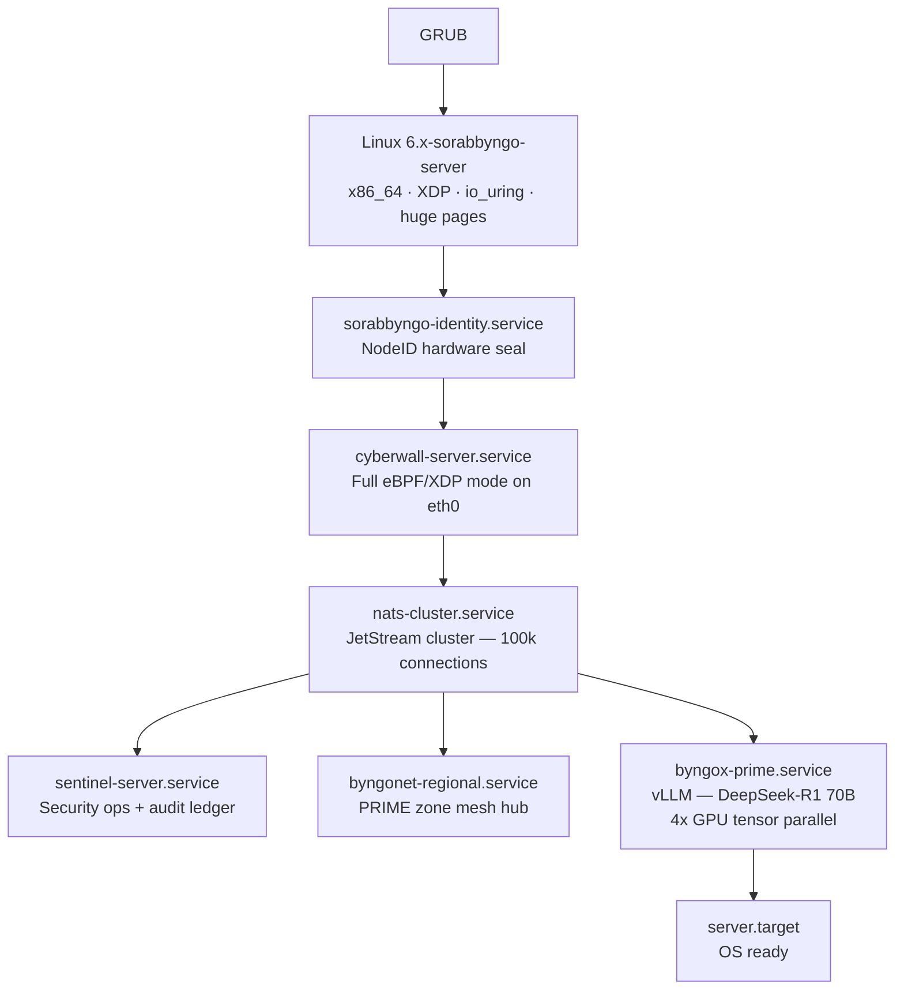

<p align="center">
  
</p>

---

The infrastructure surface of SORABBYNGO OS. Server OS powers hospital servers, Byngonet regional nodes, Byngox Prime inference clusters, and data centers across Africa.

---

## Boot sequence



---

## Deployment roles

```bash
# Hospital server — Novela backend + patient records
ROLE=hospital bash scripts/build.sh

# Byngox Prime cluster — H100/A100 vLLM inference
ROLE=prime bash scripts/build.sh

# Byngonet regional node — intelligence mesh hub
ROLE=regional bash scripts/build.sh

# Smart city infrastructure
ROLE=city bash scripts/build.sh
```

---

## What makes it different

| Feature | How |
|---|---|
| High throughput | XDP networking + io_uring — kernel bypass I/O |
| AI inference | vLLM — DeepSeek-R1 70B, 4x tensor parallel |
| Message bus | NATS JetStream cluster — 100k connections, 8MB payload |
| Data integrity | ZFS / Btrfs with checksumming |
| Full security | Cyberwall eBPF/XDP — hardware-level packet filtering |
| High availability | 3-node NATS cluster, automatic failover |

---

## Services

| Service | Role | Priority |
|---|---|---|
| `cyberwall-server.service` | Full eBPF/XDP security | Starts first |
| `nats-cluster.service` | JetStream message bus | OOM -800 |
| `byngox-prime.service` | vLLM inference (prime role) | OOM -900 |
| `byngonet-regional.service` | PRIME zone mesh hub | — |
| `sentinel-server.service` | Security ops + audit | OOM -700 |
| `server.target` | Default boot target | — |

---

## NATS cluster

3-node cluster for high availability. Configure node names via environment:

```bash
SERVER_NAME=node1 systemctl start nats-cluster
```

Nodes: `node1/2/3.sorabbyngo.internal:6222`

---

## Part of SORABBYNGO OS

| OS Surface | Role |
|---|---|
| [Byngo OS](https://github.com/sorabbyngo-Labs/byngo-os) | Consumer devices |
| [Novela OS](https://github.com/sorabbyngo-Labs/novela-os) | Medical equipment |
| [Edge OS](https://github.com/sorabbyngo-Labs/edge-os) | IoT, drones, vehicles |
| **Server OS** | Infrastructure — this repo |

---

<p align="center">
  <strong>Sorabbyngo Company</strong> &nbsp;·&nbsp; Kisii, Kenya &nbsp;·&nbsp; 2026<br/>
  <em>Rhythm of Digital Life</em>
</p>
