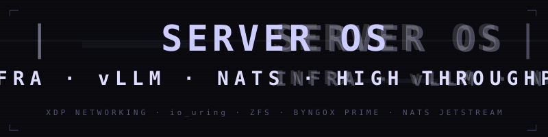
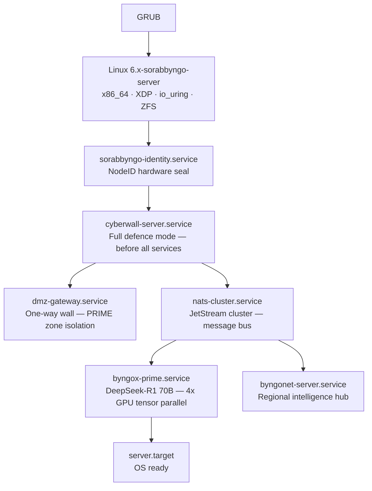

<p align="center">
  
</p>

---

The infrastructure surface of SORABBYNGO OS. Server OS powers hospital servers, Byngonet regional nodes, Byngox Prime inference clusters, and smart city infrastructure. Built for high throughput, high availability, and AI-native workloads.

---

## Boot sequence



---

## Deployment roles

```bash
# Hospital server — Novela backend + Byngox Prime
ROLE=hospital bash scripts/build.sh

# Byngox Prime cluster — H100/A100 inference only
ROLE=prime bash scripts/build.sh

# Byngonet regional hub — mesh intelligence node
ROLE=regional bash scripts/build.sh

# Smart city infrastructure node
ROLE=city bash scripts/build.sh
```

---

## What makes it different

| Feature | How |
|---|---|
| XDP networking | Kernel-bypass packet processing — line rate |
| io_uring | Async I/O — no syscall overhead |
| Byngox Prime | DeepSeek-R1 70B — 4x GPU tensor parallel via vLLM |
| NATS JetStream | Clustered message bus — 1M msg/s |
| DMZ gateway | One-way wall — PRIME zone never touches external |
| ZFS/Btrfs | Data integrity — checksums, snapshots, RAID-Z |
| IPMI | Out-of-band management |

---

## Services

| Service | Role | Priority |
|---|---|---|
| `cyberwall-server.service` | Full defence — starts first | OOM -800 |
| `dmz-gateway.service` | PRIME zone isolation | OOM -900 |
| `nats-cluster.service` | JetStream cluster | OOM -800 |
| `byngox-prime.service` | vLLM inference — 4x GPU | OOM -1000 |
| `byngonet-server.service` | Regional mesh hub | Standard |
| `server.target` | Default boot target | — |

---

## Part of SORABBYNGO OS

| OS Surface | Role |
|---|---|
| [Byngo OS](https://github.com/sorabbyngo-os/byngo-os) | Consumer devices |
| [Novela OS](https://github.com/sorabbyngo-os/novela-os) | Medical equipment |
| [Edge OS](https://github.com/sorabbyngo-os/edge-os) | IoT, drones, vehicles |
| **Server OS** | Infrastructure — this repo |

---

<p align="center">
  <strong>Sorabbyngo Company</strong> &nbsp;·&nbsp; Kisii, Kenya &nbsp;·&nbsp; 2026<br/>
  <em>Rhythm of Digital Life</em>
</p>
